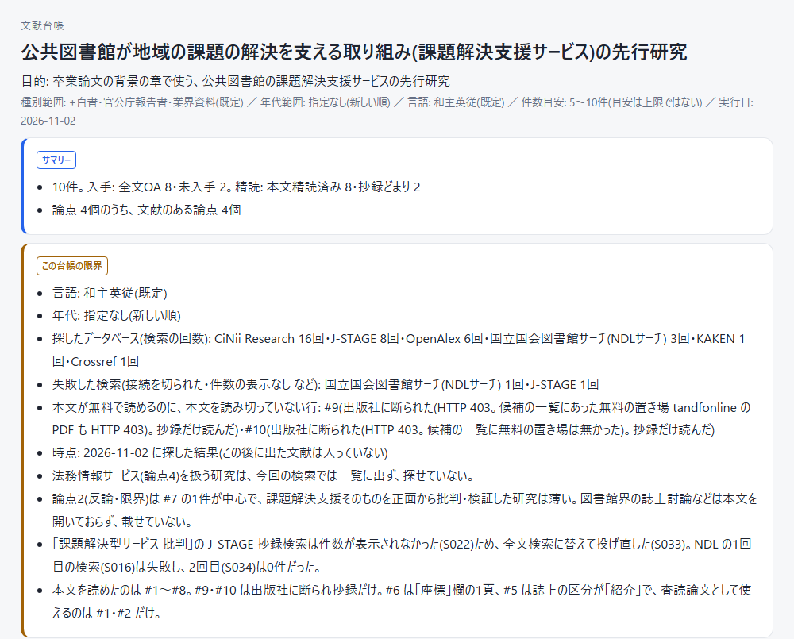
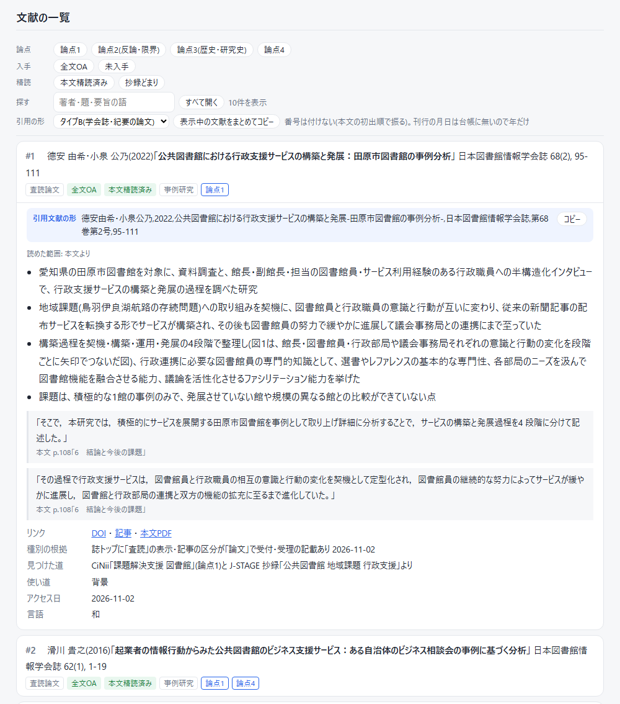

# 文献台帳のスキル(run-bunken-daicho)

**論文に引ける文献を探し、1件ずつ開いて確かめた一覧(文献台帳)にする、Claude のスキルです。**

日本語の文献(論文・紀要・白書など)を中心に、英語の文献も加えて探します。見つけた文献は1件ずつページを開いて書誌を確かめ、誰でも無料で読める本文は全部読んでから要旨を書きます。できた台帳を渡すのは、プログラムによる検査と、別の会話の確かめ役を通ってからです。

```
あなた:  「bunken-daichoで、公共図書館の課題解決支援サービスの先行研究の台帳を作って」
Claude:  テーマ・文献の種類・年代・言語・件数などの項目を見せて、承認を求める
あなた:  (論点を直して)「これで進めて」
Claude:  データベースで探す → 1件ずつページを開いて書誌を確かめる → 無料の本文を全部読む
         → プログラムの検査と、別の会話の確かめ役を通す → 台帳を渡す
```

- 書誌は、文献のページを開いて確かめた字で書きます。検索結果の見出しや Claude の記憶から写すことはしません
- 台帳のリンクの URL は、検索や本文を開いた時の記録から、プログラムが書き写します。Claude は、どの候補の文献か・どの本文を開いた記録かを、番号で指すだけです
- 誰でも無料で読める本文は、全部読んでから要旨を書きます。要旨の元にした原文の1〜2文も、頁と一緒に添えます
- 台帳は、プログラムの検査と別の会話の確かめ役の両方を通るまで、渡されません。最後に使う台帳が確かめを通っていない時は、残った指摘を見せて、あなたの判断を待ちます
- 作るのは執筆の材料をそろえた棚で、問いへの答えや結論は書きません
- 確かめられなかった所(開けなかったページ・読み切れなかった本文など)は、台帳とチャットの両方に一覧で出ます
- 1回に約30〜70分かかります(台帳10〜25行の時。行が多いほど延びます)。作者の試しの実測は、台帳10行で約31分と約43分、15行で約56分、25行で約67分でした

この README は、入れ方と使い方の手引きです。仕組みの詳しい説明は、作者が別に配る説明のページ(HTML。名前が bunken-daicho-guide で始まるファイル)にあります。

- この版を作った日: 2026-11-04(作者の管理番号 7120ab6)
- 作者が確かめた環境: Windows 11 の Claude Code で、zip を展開したフォルダから入れる方法と、消す方法を確かめました。GitHub の置き場(リポジトリ)から入れる方法は、Windows 11 で、GitHub にログインしていない形で、入れられることを確かめました(Git は要ります。打ったのは、Git Bash という画面での、Mac・Linux と同じ形の命令です)。GitHub から入れる命令を PowerShell の形で打つことは、確かめていません。Mac・Linux は確かめていません。claude.ai は一部だけを確かめました(下の「方法2」に書きました)

## 作った人から

作者は、論文を書いたことと、学会で発表したことがあります。そのとき欲しかったのは、論文にそのまま引ける、確かめ済みの文献の一覧でした。このスキルは、その立場から作っています。書誌を1件ずつ確かめ、本文を読んだかどうかを行ごとに書くのは、論文に引いた後で誤りが見つかるのを避けるためです。

いっぽうで、作者は AI については初心者です。うまく動かない所や、直したほうがよい所があれば、教えてください。作者が入っているコミュニティの会員の方は、そのコミュニティにある作者のつぶやきチャンネルで受け付けます。そのほかの方は、GitHub の置き場の Issues(https://github.com/atoreti/bunken-daicho/issues)に書いてください(書くには GitHub のアカウントが要ります)。

## 何がうれしいのか

**なぜ1件ずつページを開くのか。** 検索結果の見出しや Claude の記憶から書誌を写すと、実在しない文献が混ざるからです。このスキルは、文献のページか DOI のページを開いて確かめた字だけを台帳に書きます。英語の大手の出版社のように、プログラムからのページの取得を断るサイトの時だけは、DOI の登録の記録(Crossref)を開いて確かめます。

**なぜ別の会話の確かめ役を通すのか。** 書き写した本人(台帳を書いた会話の Claude)は、自分の写し間違いに気づきにくいからです。作者の台帳でも、著者名3か所と出版社名1か所が別の字に化けたまま残っていたことがありました。確かめ役は、台帳を書いた会話とは別に立てた Claude で、全行の書誌をリンク先と1項目ずつ突き合わせます。プログラムの検査(チェッカー)も、リンクが今も届くか、書誌が DOI の登録の記録と合うか、抜き書きした原文が本当に元の論文(原典)にあるかを照らし合わせます。

**なぜ本文を全部読むのか。** 冒頭と結びだけで要旨を書くと、何をどう調べて何を示した研究かを取り違えるからです。本文を開いた記録はプログラムが残します。開かずに論文の短い要約(抄録)だけで済ませた行があると、プログラムが台帳を作りません。文字にならない図や表の頁は、頁を画像にして読みます。

**なぜ件数より論点で止めるのか。** 件数がそろった時点で止めると、反論や限界の論点が空のまま終わりやすいからです。最初に、執筆で要る論点を3〜6個立て、「反論・限界」と「歴史・研究史」の論点は毎回入れます。探すのを止めるのは、どの論点にも採った文献か「探したが見つからなかった」記録が付き、その分野の中心の研究者と定番の学会誌を一度はたどった時です。途中で打ち切った時も、確かめた分を台帳にして渡し、まだ探せていない論点と次の一手を探索記録に書きます。

**なぜ材料の棚にとどめるのか。** 台帳をどう読み、何を結論にするかは、書く人が決めることだからです。台帳は、論点ごとに文献をそろえ、それぞれの本文を読んだか・誰でも無料で読めるかの印を付けて渡します。

## 見た目

作者の試しで作った台帳です(公共図書館の課題解決支援サービスの先行研究・10件)。台帳はブラウザで開く HTML です。

| 台帳の頭: サマリー(台帳のまとめ)と、この台帳の限界 | 文献の一覧: 1件を開いたところ |
|---|---|
|  |  |

- 文献の一覧は、論点・入手・精読で絞って見られます。入手は、本文がどこまで手に入るかの印です。「全文OA」は誰でも無料で全文を読める文献、「未入手」は書誌は確かめたが本文にまだたどり着けていない文献です(ほかに、抄録のみ・有料・学内限定があります)。精読は、本文を全部読んだか(本文精読済み)、抄録だけか(抄録どまり)の印です。要旨はこのスキルが書く文で、抄録は論文に初めから付いている短い要約です。
- 1件を開くと、引用文献の形・要旨・要旨の元にした原文(頁つき)・リンク・見つけた道(どの検索で見つけたか)が出ます。
- 左の画面の #9・#10 は、出版社に本文の取得を断られた論文です。断られたことを理由に書いた行は、抄録だけでも台帳に残ります。

## 入れ方

このスキルのプログラムは、あなたの PC で、あなたの権限で動き、ネットにつながります。入れる前に、`skills/` の中(手順書の `SKILL.md` と、プログラムの `scripts/`)を見てかまいません。Claude に読ませて、何をするかを確かめてもらうのもよい方法です。外へ送る物は、下の「外へ送る物」の表にまとめました。

届いた物が欠けたり書き換わったりしていないかは、`MANIFEST.json` で確かめられます。zip を展開したフォルダと GitHub の置き場の、一番上にあるファイルです。全部のファイルについて、中身から計算した値(sha256 の欄)が書いてあり、中身が1字でも違うと、この値も変わります。Windows の PowerShell では、`Get-FileHash ファイルの名前` と打つと、そのファイルの値が出ます(Mac は `shasum -a 256 ファイルの名前`、Linux は `sha256sum ファイルの名前`。作者は未確認)。出た値と、`MANIFEST.json` のそのファイルの値を見比べます(大文字と小文字の違いは気にしなくてかまいません)。

### 方法1: Claude Code に入れる(推奨)

スキルは、npx skills という命令で入れます。いろいろな AI の道具にスキルを入れるための、共通の命令です(https://github.com/vercel-labs/skills)。スキルのプログラムが使う Python の部品は、uv という道具が用意します(https://docs.astral.sh/uv/)。uv は、プログラムを走らせる時に、部品を uv 専用の置き場に用意します。あなたの PC に入っている Python と、その部品は変わりません。Python が入っていなければ、Python も uv が取ってきます。

先に、次の2つを用意してください。

- Node.js の 22.20 以降。npx skills を動かすのに使います。https://nodejs.org/ja から、LTS(長く手入れが続く版)と書かれた版を入れます。入っている版は、`node --version` と打つと分かります。入っている版が 22.20 より古い時は、LTS の版を入れ直します。
- CiNii のアプリケーション ID(取り方は下の「CiNii の ID と OpenAlex のキー」)

1. uv を入れる。uv の公式の説明(https://docs.astral.sh/uv/getting-started/installation/)にある命令です。既に uv が入っている時は、この手順を飛ばします。

Windows(PowerShell):

```powershell
powershell -ExecutionPolicy ByPass -c "irm https://astral.sh/uv/install.ps1 | iex"
```

Mac・Linux(ターミナル):

```bash
curl -LsSf https://astral.sh/uv/install.sh | sh
```

   入れ終わったら、PowerShell(Mac・Linux はターミナル)を閉じて開き直し、`uv --version` と打って、版の番号が出るのを確かめます。

2. スキルを入れる。下の「GitHub から入れる」か「zip から入れる」の、どちらか1つをします。
3. スキルの設定ファイルを作り、CiNii の ID を書く(下の「置き方」。OpenAlex のキーと、使うデータベースの設定も、同じファイルに書く)。
4. 試験を走らせ、最後の行が「試験: 354項目中 354合格 / 0不合格」になるのを確かめる。スキルのプログラムが正しく動くかを確かめる試験です。初めて走らせる時は、uv が PDF を読む部品(PyMuPDF)を取ってきます(Python が無ければ Python も)。ネットにつないだ状態で打ってください。試験そのものは、ネットに出ません。

Windows:

```powershell
uv run "$env:USERPROFILE\.claude\skills\run-bunken-daicho\scripts\test_scripts.py"
```

Mac・Linux:

```bash
uv run ~/.claude/skills/run-bunken-daicho/scripts/test_scripts.py
```

5. Claude Code を開き直す(新しいスキルは、会話の始めに読まれるため)。

PyMuPDF は、本文の PDF を文字にし、文字の取れない頁を画像にする部品です。無いと、本文を読む工程と、引いた文の照合が動きません。

#### GitHub から入れる

スキルは、作者の GitHub の公開の置き場(リポジトリ。`atoreti/bunken-daicho`。https://github.com/atoreti/bunken-daicho)に置いてあります。公開なので、GitHub のアカウントとログインは要りません。npx skills は Git(プログラムの置き場を取り込む道具)を使うので、Git が要ります。入っているかは `git --version` と打つと分かり、入っていなければ https://git-scm.com から入れます。

PowerShell(Mac・Linux はターミナル)で、次を打ちます。作者は、Windows 11 で、GitHub にログインしていない形で、入れられることを確かめました(2026-11-04)。ただ、作者が打ったのは、Git に付いてくる Git Bash という画面での、Mac・Linux と同じ形の命令です。PowerShell の `npx.cmd` の形では打っていません。Mac と Linux の PC でも打っていません。PowerShell の形で動かない時は、Git Bash を開いて(スタートメニューで「Git Bash」を探して開きます)、Mac・Linux の形を打ってください。

Windows:

```powershell
$env:DISABLE_TELEMETRY = "1"
npx.cmd skills@1.7.6 add atoreti/bunken-daicho -g -a claude-code -y
```

Mac・Linux:

```bash
DISABLE_TELEMETRY=1 npx skills@1.7.6 add atoreti/bunken-daicho -g -a claude-code -y
```

#### zip から入れる(作者から zip を受け取った人)

GitHub と Git を使わずに入れられます(npx skills の本体と uv の部品を取ってくるので、ネットへの接続は要ります)。

1. zip を展開する(Windows は右クリックして「すべて展開」、Mac はダブルクリック、Linux は `unzip` の命令)。
2. 展開したフォルダ(`bunken-daicho-share` の中。この README がある所)で、PowerShell(Mac・Linux はターミナル)を開く。Windows は、エクスプローラーでそのフォルダを開き、上のアドレス欄に `powershell` と打って Enter を押すと、そのフォルダで開きます。Mac・Linux は、ターミナルで `cd` と空白を打ってから、フォルダをターミナルの画面に引きずって落とし、Enter を押します。
3. 次を打つ。`add` のすぐ後ろの `.`(ピリオド1つ)は、「今いるフォルダから入れる」という意味です。同じ名前のスキルのフォルダが既にあれば、フォルダごと入れ替えます。

Windows:

```powershell
$env:DISABLE_TELEMETRY = "1"
npx.cmd skills@1.7.6 add . -g -a claude-code -y
```

Mac・Linux:

```bash
DISABLE_TELEMETRY=1 npx skills@1.7.6 add . -g -a claude-code -y
```

#### 命令の意味と、出てくる問い

- 初めて打つ時は、npx が npx skills の本体を取ってきてよいかを聞きます(`Ok to proceed? (y)`)。`y` を押して進めます。
- `-g` は、あなたのホームフォルダ(Windows では `%USERPROFILE%`、Mac・Linux では `~`)の `.claude/skills` に入れるという意味です。どのフォルダで Claude Code を開いても読まれる置き場です。`-a claude-code` は Claude Code に入れる、`-y` は途中の確認を飛ばす、という意味です。`skills@1.7.6` は、作者が試した npx skills の版です。
- `DISABLE_TELEMETRY` の部分(Windows では1行目、Mac・Linux では命令の頭)は、npx skills が、誰が使ったか分からない形の、使い方の記録を、npx skills を作った人たちへ送るのを止める設定です。npx skills の説明書にある止め方です。npx skills は、GitHub で公開になっているリポジトリから入れた時は、リポジトリとスキルの名前も送ります。このリポジトリは公開なので、止めずに GitHub から入れると、その名前も送られます(下の「外へ送る物」)。
- Windows で `npx` でなく `npx.cmd` と打つのは、PowerShell は `npx` をスクリプトとして動かそうとしますが、Windows の初めの設定ではスクリプトの実行が止められているためです。
- npx skills は、入れたスキルの出どころを、ホームフォルダの `.agents/.skill-lock.json` に書きます。下の「新しい版が出た時」と「消す時」の命令が、これを読みます。
- 4つのスキルが組で入ります。チェッカー本体は、チェッカーの使い方の説明書(ref-nohin-checker)のフォルダの中に入っています。

#### Mac・Linux で気をつけること

作者は、Mac と Linux では、この入れ方を確かめていません。

Mac で python.org から入れた Python がある時は、uv がその Python を使うことがあります。その時は、台帳づくりを始める前に、次をしてください。Finder で「アプリケーション」を開き、「Python 3.12」のような名前のフォルダの中の「Install Certificates.command」を、一度ダブルクリックします。しておかないと、ウェブサイトが本物であることを示す証明書を Python が確かめられず、検索と本文の取得が全部失敗します。手順4の試験はネットに出ないので、しておかない時も通るはずです(Mac でよく知られた問題です。作者は未確認)。

### 方法2: claude.ai に入れる

1. claude.ai の「設定」→「機能(Capabilities)」を開き、「コードの実行とファイルの作成」を ON にする。
2. 同じ画面の「スキル」で「スキルをアップロード」を押し、`claude-ai` フォルダの .skill を4つ、1つずつ上げる。
3. 同じ「コードの実行」の所にある、外のサイトへの接続の設定で、次のサイトへの接続を許す(画面の名前は変わることがあります。作者は未確認)。
   - 日本語の検索のサイト: `ci.nii.ac.jp`・`cir.nii.ac.jp`・`kaken.nii.ac.jp`・`ndlsearch.ndl.go.jp`・`www.jstage.jst.go.jp`
   - 英語の検索のサイト: `api.openalex.org`・`api.semanticscholar.org`・`export.arxiv.org`
   - DOI を登録している機関: `doi.org`・`api.crossref.org`・`api.japanlinkcenter.org`・`api.datacite.org`
   - 本文を読むプログラムは、大学が論文を公開するサイト(リポジトリ)や arXiv(`arxiv.org`)など、本文を置いているサイトを開きます。チェッカーは、台帳に載せた全部のリンク先を開きます。どちらも前もって数え切れないので、すべてのサイトへの接続を許す選び方があれば、それが確実です。上の一覧だけに絞ると、本文を開けない行が増え、照合も「測れなかった」で止まります。
   - PyMuPDF を入れる時は、Python の部品の置き場(`pypi.org`・`files.pythonhosted.org`)も要るかもしれません(作者は未確認)。

claude.ai では、次のことが Claude Code と違います。

- スキルの設定ファイルを置けないので、CiNii と KAKEN の検索は止まり、手で検索して記録する形に切り替わります(J-STAGE と NDL サーチは ID が無くても動きます)。
- 使うデータベースを選ぶ設定(下の「使うデータベースを選ぶ」)も置けないので、8つ全部を使う形で動きます。規約が合わないデータベースがある時は、Claude Code で使ってください。
- OpenAlex はキー無しで動きます。ただ、キー無しの1日の枠は同じ回線から使う人みんなで分け合うので、早く尽きるかもしれません(作者は未確認)。尽きた時は、プログラムが止まって知らせ、Claude が同じ語をほかの英語のデータベースに送ります。
- チェッカーが「原典に到達できない」という注意を出すことがあります。チェッカーは自分の規則の出どころの文書を探しに行きますが、claude.ai に上げた形では、その文書が見つからないことがあるためです。合否には影響しないので、読み飛ばしてかまいません(作者は未確認)。
- 走らせた記録が PC に溜まらないので、記録の1行が渡す時のチャットに出ます。
- 外のサイトに届くか、確かめ役が別の会話として動くかは、作者は一部しか確かめていません(未確認)。

### CiNii の ID と OpenAlex のキー

**CiNii の ID の取り方(無料。Claude Code で使う時は必須)**

1. CiNii の案内ページ https://support.nii.ac.jp/ja/cinii/api/developer を開く。
2. 「CiNiiウェブAPI デベロッパー登録」(https://api.ci.nii.ac.jp/ja/)から申し込む。利用規程と「学術コンテンツサービスウェブAPI利用細則」への同意が要ります。
3. 届いたアプリケーション ID は、KAKEN の検索にも使えます(案内ページに「KAKEN API の利用にも必要」とあります)。

**OpenAlex のキーの取り方(無料・任意)**

キーが無くても、OpenAlex の検索は動きます。ただ、キー無しの1日の枠はキー有りの10分の1で(OpenAlex のヘルプ https://help.openalex.org/how-to-use-the-api/rate-limits-and-authentication)、同じ回線から使う人みんなで分け合うので、英語の論文を多く探す人は、キーを取ると止まりにくくなります。

1. https://openalex.org/signup でアカウントを作る。
2. https://openalex.org/settings/api-key を開き、表示されたキーを写す。
3. 無料のアカウントで、1日 $1 分(語の検索 約1,000回)まで使えます(公式の値段のページ https://openalex.org/pricing)。前払いを足さない限り、支払いは起きません。枠が尽きるとその日の OpenAlex の検索は止まり(日本時間の朝9時に戻る)、Claude が同じ語をほかの英語のデータベースに送ります。

キーは openalex.org へのサインインにも使うので、ID と同じく人に見せないでください。

**置き方**(ID とキーはチャットに貼らないでください。会話の記録に残るため)

ID とキーは、このスキルのプログラムだけが読む設定ファイル(スキルの設定ファイル)に書きます。置き場は次のとおりです。

- Windows: `%USERPROFILE%\.claude\bunken-daicho\settings.json`
- Mac・Linux: `~/.claude/bunken-daicho/settings.json`

1. 次を打って、スキルの設定ファイルのひな形を作ります。`CINII_APPID`(CiNii の ID)・`OPENALEX_API_KEY`(OpenAlex のキー)・`BUNKEN_DB`(使うデータベース)の3つの名前を、値を空にして書いたファイルができます。Mac・Linux では、あなただけが読める形で作ります。ファイルが既にある時は、作り直さずに、3つの名前をそれぞれどこから読むかだけを出します(値は出しません)。`settei` の前の `.` は、プログラムの作業に使うフォルダの指定です。この命令は、そこに何も置きません。

Windows:

```powershell
uv run "$env:USERPROFILE\.claude\skills\run-bunken-daicho\scripts\kensaku.py" . settei
```

Mac・Linux:

```bash
uv run ~/.claude/skills/run-bunken-daicho/scripts/kensaku.py . settei
```

   Claude Code に「bunken-daicho の設定ファイルのひな形を作って」と頼んでも、同じ命令で作れるはずです(作者は未確認)。

2. スキルの設定ファイルをエディタで開き、`""` の間に ID とキーを書いて保存します。

   Windows は、次を打つとメモ帳で開きます。

```powershell
notepad "$env:USERPROFILE\.claude\bunken-daicho\settings.json"
```

   Mac・Linux は、ターミナルで次を打つと、ターミナルの中で書けます(Ctrl+O と Enter で保存し、Ctrl+X で閉じる。作者は未確認)。

```bash
nano ~/.claude/bunken-daicho/settings.json
```

   書いた後のファイルは、次のようになります。

```json
{
  "CINII_APPID": "ここに取った ID",
  "OPENALEX_API_KEY": "ここに取ったキー",
  "BUNKEN_DB": ""
}
```

   使わない物は、`""` のまま残します。空のままの名前は、置いていないのと同じに扱います。`"` と `,` は消さないでください。書き方を誤ると、プログラムは「スキルの設定ファイル … が読めない」と出して止まります。`BUNKEN_DB` は、下の「使うデータベースを選ぶ」で使う名前です。

3. 手順1の命令をもう一度打って、確かめます。3つの名前のそれぞれに、「設定ファイルから読む」「置いていない」などが出ます(値は出ません)。

ID が無いまま検索すると、プログラムは「CINII_APPID(CiNii と KAKEN のアプリケーション ID)が無いので、投げずに止めた」と出して、検索を送らずに止まります。ID とキーの値は、プログラムが記録にも画面にも出しません。

**前の版の置き方**

前の版では、Claude Code の設定ファイル(`~/.claude/settings.json`)の中の `env` という欄か、Windows のアカウントの環境変数に置きました。環境変数は、プログラムに値を渡すための、名前つきの設定です。どちらの置き場も今も読みます。ただ、`env` の欄に置いた値は、どのフォルダの会話でも、Claude が走らせる全部の命令に渡ります。Windows のアカウントの環境変数も、あなたの PC で動くほかのプログラムから見えます。スキルの設定ファイルなら、読むのはこのスキルのプログラムだけなので、こちらを勧めます。

前の置き場に置いた人は、値をスキルの設定ファイルに写してから、前の置き場のその名前(`CINII_APPID` など)を消してください。前の置き場の値は、スキルの設定ファイルより先に使われるからです(Windows のアカウントの環境変数だけは、Claude Code を開いた後に置いた物なら、スキルの設定ファイルの値のほうが使われます)。

ふつうは、スキルの設定ファイルの置き場を変える必要はありません。別の場所に置きたい時だけ、環境変数 `BUNKEN_SETTEI` に、そのファイルの場所を書きます。

### 使うデータベースを選ぶ(仕事で使う時など)

8つのデータベースは、営利の目的で使ってよいかの決まり(規約)が、サービスごとに違います。仕事で使う時などは、下の早見表で決まりを見て、合わないサービスを設定で外してください。仕事で使うことが営利の目的に当たるかは、勤め先や使い方によって変わります。設定を置かなければ、8つ全部を使います。

**営利の目的で使う時の決まり(早見表)**

| サービス(設定に書く名前) | 営利の目的で使う時 | 規約(作者が読んだ日) |
|---|---|---|
| CiNii(`cinii`)・KAKEN(`kaken`) | 学術研究か非営利の利用に限ります。それ以外の目的は、書面で申請して承認を受けます | [CiNii のウェブ API 利用細則](https://support.nii.ac.jp/sites/default/files/cinii/webapi-term.pdf)・[学術コンテンツサービス利用規程](https://support.nii.ac.jp/sites/default/files/cinii/content_services-term_1.pdf)(2026-10-31) |
| NDL サーチ(`ndl`) | 収益を得ない利用は、申請が要りません。営利の利用は、申請が要ります | [API の案内](https://ndlsearch.ndl.go.jp/help/api)(2026-10-31) |
| J-STAGE(`jstage`) | 営利を目的として、プログラムなどで自動に J-STAGE にリンクを張ったり、検索したりする時は(リンクポリシーの言葉では「システム的なリンクや検索」)、前もって JST(J-STAGE を運営する科学技術振興機構)の書面の承認が要ります。プログラムから検索する窓口(API)を営利の目的で使う時も、申請して承認を受けます。ほかの決まりと、このスキルの取り方は、表の下に書きました | [閲覧規約とリンクポリシー](https://www.jstage.jst.go.jp/static/pages/TermsAndPolicies/ForIndividuals/-char/ja)(2026-11-03)・[WebAPI 利用規約](https://www.jstage.jst.go.jp/static/pages/WebAPI/-char/ja)(2026-10-31) |
| Semantic Scholar(`semanticscholar`) | 利用の決まりの文書には、営利の目的で使ってよいかが、直接は書かれていません。取ったデータには、データごとに別の条件が付きます。その例として、営利の目的には使えない条件(CC BY-NC)と、出典を示せば使える条件(ODC-BY)が挙がっています | [API の利用の決まり](https://www.semanticscholar.org/product/api/license)(最終更新 2023-05-17。読んだ日 2026-11-03) |
| arXiv(`arxiv`) | 書誌(題名・著者など)は、だれでも目的を問わず使える決まり(CC0)です。論文の本文の著作権は、論文ごとに違います | [API の利用規約](https://info.arxiv.org/help/api/tou.html)(2026-11-03) |
| OpenAlex(`openalex`) | データは、だれでも目的を問わず使える決まり(CC0)です | [よくある質問](https://docs.openalex.org/additional-help/faq)(2026-11-03) |
| Crossref(`crossref`) | 書誌は、目的を問わず使えます。ただ、Crossref から取れる情報のうち、抄録には、出版社や著者が著作権を持つ物があります | [REST API の説明](https://www.crossref.org/documentation/retrieve-metadata/rest-api/)(2026-11-03) |

**J-STAGE のほかの決まりと、このスキルの取り方**

- J-STAGE のサイトには、プログラムで自動にページを取る物(ロボット)に向けた決まりのファイル(https://www.jstage.jst.go.jp/robots.txt)があります。そこでは、名前を挙げて許した一部を除く全部のロボットに、アドレスに `_pdf` を含むページ(本文の PDF)を取らないよう求めています(2026-11-03 に読んだ)。
- 閲覧規約の第3条1項(5)は、機械的な手段で、載っているデータを大量にダウンロードすることを禁じています。
- このスキルは、J-STAGE の検索の画面と本文の PDF を、プログラムで取ります。robots.txt が取らないよう求めている本文の PDF も、取ることになります。取る時は1本ずつ、前に送ってから6秒以上あけて取り、本文の PDF は、台帳に載せようとする文献の分だけを取ります。
- 設定で `jstage` を外すと、J-STAGE の検索も、本文の PDF も取りません。J-STAGE にしか本文の無い文献は、本文を読み切れなかった行になります。ただし、チェッカーと確かめ役が台帳の DOI のリンクを開くと、J-STAGE の文献のページに転送されることがあります(下の「外へ送る物」)。
- このスキルの取り方がこれらの決まりに合うかを、作者は保証できません。決まりの当てはめは、使う人の責任で行ってください。

早見表は、作者が規約を読んで、要点を短く書いた物です。規約は変わることがあり、作者の読み違いもありえます。あなたの使い方に規約を当てはめるのは、使う人の責任で行ってください。作者は、この表が正しいことも、あなたの使い方が許されることも、保証できません。分からない時は、そのサービスに問い合わせるか、そのサービスを設定から外してください。

**外し方**(書く所は、CiNii の ID と同じスキルの設定ファイルです)

設定の名前は `BUNKEN_DB` です。値には、使うサービスの名前(上の表のかっこの中の英字)を、カンマで区切って並べます。書いた物だけを使い、書かなかった物は外れます。1つだけ外す時も、残りの7つを全部書きます。大文字でも小文字でもよく、名前の間に空白があってもかまいません。値が空の時は、置かなかった時と同じく、8つ全部を使います。

例: 目的を問わず書誌を使える3つ(OpenAlex・arXiv・Crossref)だけにする時は、スキルの設定ファイルをこう書きます(本文と抄録の扱いは、早見表の各行を見てください)。

```json
{
  "CINII_APPID": "",
  "OPENALEX_API_KEY": "ここに取ったキー",
  "BUNKEN_DB": "openalex,arxiv,crossref"
}
```

この例は CiNii と KAKEN を外したので、`CINII_APPID` は空のままでかまいません。値は `["openalex", "arxiv", "crossref"]` のように、名前を1つずつ `""` で囲んで並べる形で書いてもかまいません。

外したデータベースについては、次のことをしません。

- プログラムが検索を送ること(その検索だけを取りやめ、台帳づくりは続きます)
- そのデータベースのサイトのページを、プログラムが開くこと。本文を読むために本文の置き場を開く時(J-STAGE の本文の PDF など)と、台帳の文献のページを開き直して確かめる時も同じです
- 検索の外で見つけた文献(引用をたどって見つけた文献など)のうち、そのデータベースのサイトにある物を、候補の一覧に足すこと
- Claude がブラウザでそのデータベースを開いて検索し、その結果を探した記録に書くこと
- 英語の論文の抄録を取り寄せる時に、そのデータベースに問い合わせること

Claude は、同じ語をほかのデータベースに送ります。外したデータベースにしか載っていない文献は、見つかりにくくなります。たとえば日本語のデータベース4つを全部外すと、日本語の文献は、英語のデータベースに載っている物の中から探すことになります。名前を書き違えると(例 `ciniii`)、プログラムは「知らない名前がある」と出して止まるので、設定を直してください。

使うデータベースは、台帳づくりを頼んだ時の最初の確認の表(「検索の手段」の行)に出ます。設定が効いているかは、そこで確かめてください。

設定で止まらない送り先もあります。チェッカーが台帳の DOI を、DOI を登録している機関に問い合わせることと、チェッカーと確かめ役が台帳のリンク先を開くことです。くわしくは、下の「外へ送る物」の表にあります。

## 使い方

Claude Code(か claude.ai)の入力欄で、こう頼みます。

- 「bunken-daichoで、〇〇の先行研究の台帳を作って」 → 使うかどうかは聞かずに、スキルを使います(最初に下の表の項目を見せて、承認は求めます)
- 「文献を探して」「先行研究はある?」 → 使うかどうかを一言聞いてきます
- Claude Code では、入力欄に `/run-bunken-daicho 〇〇の先行研究` と打っても始められます

最初に、次の項目を見せて、承認を求めてきます。

| 項目 | 選べること |
|---|---|
| テーマ・目的 | 何の執筆に使うか |
| 文献の種類 | 査読論文だけ / 紀要・学位論文まで / 白書・官公庁の報告書・業界の資料まで(既定) |
| 年代 | 指定なし(新しい順) / 直近N年 / 古典(分野の基本になった古い文献)も含む |
| 言語 | 和主英従(日本語を主に、英語も探す。既定) / 和のみ |
| 件数の目安 | 5〜10件(既定) / 指定。目安は目標で、上限ではありません |
| 検索の手段(エンジン) | 選びません。いつもデータベースを直に検索します(英語のデータベースを使うかは、言語の項目で決まります)。使うデータベースと、設定 `BUNKEN_DB` で外したデータベースが、ここに出ます |
| 執筆で要る論点・台帳に載せる条件・探し方 | 論点3〜6個と、載せる文献の条件1文と、中心の研究者と学会誌の1行 |

- 論点は、あなたが直した文がそのまま使われます。20件以上を頼むと、時間の見積もりと、何回かに分けて頼む案も示します。
- 「確認を求めずに最後まで進めて」のように、確認に答えられない頼み方をした時は、自分で立てた論点で進めます。そして渡す時のチャットに、論点と台帳に載せる条件をそのまま書いて、承認を求めます。
- 探す先は、日本語の文献のデータベース4つ(CiNii・J-STAGE・NDL サーチ・KAKEN)と、英語の文献のデータベース4つ(OpenAlex・Semantic Scholar・arXiv・Crossref)です。日本語はテーマに合う物を選び、英語は主に OpenAlex・Semantic Scholar・Crossref の3つで探します。arXiv(査読前の論文の置き場)は、機械学習や統計などの手法の論点で使います。設定で外したデータベースは使いません(上の「使うデータベースを選ぶ」)。
- 言語の既定は「和主英従」です。日本語の文献を中心にしつつ、どの論点でも、英語のデータベースも使って探します。依頼に合う英語の文献は、数を絞らずに載せます。英語の文献を入れたくない時は、言語の項目で「和のみ」に直してください。英語の論文の要旨は日本語で書かれ、抜き書きは英語の原文のまま入ります。arXiv の前刷り(査読前の論文)は、種別が「プレプリント」になります。
- Google Scholar は、サイトの決まりが自動の取得を禁じているので、スキルは開きません。使いたい時は、スキルが整えた検索の語をあなたが手で検索し、結果を貼り戻します。

## 本文の読み方と、読み切れなかった時

- 全文が誰でも無料で読める文献は、プログラムが本文の置き場を開いて保存し、開いた記録を残します。本文を読んだ置き場の URL は、台帳のリンクの欄にも入ります。
- 台帳に次のような行(文献)があると、プログラムは台帳を作りません(止まる条件は、ほかにもあります)。
  1. 本文が誰でも無料で読めるのに、開かずに抄録だけで済ませた行
  2. 開いた記録の置き場が、その行のリンクにも候補の置き場にも無い行(別の文献を開いたかもしれない行)
- 本文の置き場を開いたのに台帳に載せなかった文献と、載せたが本文を読んでいない文献は、台帳を止めずに、渡す時のチャットに一覧で出ます。件ごとに、すること(載せなかった理由を書く・行のリンクに足す・全部読むか読み切れなかった理由を書く)と、候補の一覧にあった件はその判定(落とした・保留・採った・判定していない)が並びます。読みにくいことは、理由になりません。
- 読み切れなかった行は、理由と読んだ範囲が、台帳の限界の欄と渡す時のチャットに並びます。理由は、200頁以上・画像でも読めない頁・出版社に断られた・開けなかった・置き場に本文が無い、の5つのどれかです。壊れた PDF やパスワード付きの PDF は「開けなかった」に入ります。

## 台帳はいつも同じ形

渡される物は次の3つで、置き場を指定しなければ、会話の作業フォルダ(Claude Code なら開いているフォルダ)に置かれます。

| ファイル | 中身 |
|---|---|
| 台帳の JSON(`<台帳名>.json`) | 台帳の元になるデータ。直す時はここを直して作り直す |
| 見るための HTML(`<台帳名>.html`) | ブラウザで開いて読む台帳。上の「見た目」の画面 |
| 書誌のファイル(`<台帳名>.shoshi.json`) | 著者名・年・題名・誌名・巻・号・頁・出版社を、項目に分けた物 |

HTML の並びは毎回同じです。上から順に、題と目的、サマリー、この台帳の限界、台帳の確かめ、論点ごとの文献の数、文献の一覧、論文の方法の節の下書き、探した記録、凡例と並びます(中身の無い時は出ない欄もあります)。文献の一覧では、表示中の文献の引用文献の形をまとめてコピーできます。

渡す時のチャットには、チェッカーが見るリンク・書誌・抜き書きのそれぞれについて、確かめた数と、測れなかった数が出ます。測れなかった物は、1件ずつの一覧になります。リンク・書誌・抜き書きの確かめの結果は、チェッカーが出した形のまま、台帳の「探した記録」の中の「機械照合の申告」に入ります。

## 外へ送る物

スキルを入れる時と台帳づくりの間に、あなたの PC から外へ送る物と、その止め方です。プログラムの問い合わせには、どのプログラムからの問い合わせかを示す名前(run-bunken-daicho など)を付けます。あなたの名前やメールは付けません。CiNii・KAKEN と OpenAlex には、スキルの設定ファイルに ID とキーを書いた時だけ、下の表のとおり、それも付けます。

| 送る物 | 送る先 | 設定で止められるか |
|---|---|---|
| 検索の語(研究のテーマ。英語に直した語も) | 使うデータベース。語は、そのデータベースの運営者に届きます | 止められます。`BUNKEN_DB` で外したデータベースには送りません |
| CiNii の ID | CiNii と KAKEN だけ | ID を書かなければ送りません(その時は CiNii と KAKEN の検索も止まります) |
| OpenAlex のキー | OpenAlex だけ。キーを付けた検索は、あなたの OpenAlex のアカウントに結び付きます | キーを書かなければ、キー無しで検索を送ります |
| 本文の取り寄せ | 本文を置いているサイト(大学のリポジトリ・J-STAGE・arXiv など) | 外したデータベースのサイトは開きません。大学のリポジトリなど、ほかのサイトは止まりません |
| 台帳の DOI | DOI を登録している機関(JaLC・Crossref・DataCite)。チェッカーが書誌を確かめるために問い合わせます | 止まりません |
| 台帳のリンク先を開く問い合わせ | リンク先のサイト。チェッカーと確かめ役が開きます。DOI のリンクは、開くと本文の置き場(J-STAGE など)に転送されることがあります | 止まりません。外したデータベースのサイトに転送される時も開きます |
| npx skills の使い方の記録(スキルを入れる時) | npx skills を作った人たち。npx skills は、GitHub で公開になっているリポジトリから入れた時は、リポジトリとスキルの名前も送ります(npx skills の説明書の「Telemetry」の所)。このリポジトリは公開なので、止めずに GitHub から入れると、その名前も送られます。作った人たちが運営するスキルの一覧のサイト(skills.sh)に、このスキルの名前が載ることもあるようです(作者は未確認) | 止められます。この README の命令は、どれも `DISABLE_TELEMETRY` で止めています |
| 会話そのもの(あなたの頼み・論点・読んだ本文) | Anthropic(Claude を動かす会社) | 止められません。Claude を使う時の決まりに従います |

チェッカーの問い合わせ先のうち、JaLC の一般向けの利用規約([一般向けデータ提供サービス利用規約](https://japanlinkcenter.org/top/doc/JaLC_general_riyoukiyaku.pdf)の第5条2項。2026-11-03 に読んだ)は、DOI と書誌データと、文献のページのアドレス(規約の言葉では URI)を、目的を問わず使えるとしています(論文の抄録は、別の条件があります)。Crossref は、上の早見表の行のとおりです。DataCite の決まりは、作者は読んでいません。

## 気をつけること

- J-STAGE は、短い時間に大量に自動で接続すると、接続を切ります(作者も実際に切られました)。プログラムは6秒以上あけて1本ずつ検索を送りますが、台帳づくりを同時に何本も走らせないでください。
- Claude Code は、許可の設定によっては、プログラム(`uv run` の命令)を動かすたびに、許可を求める画面を出します。台帳づくりではプログラムを何十回も動かし、許可の画面が出ている間は止まって待ちます。席を離れる前に、毎回聞かれる設定になっていないかを確かめてください。
- 作業用のフォルダ(会話の作業フォルダとは別の一時フォルダ)には、読んだ文献の本文 PDF と頁の画像が入ります。台帳と一緒に配らないでください。
- 走らせた記録は `~/.claude/bunken-daicho-kiroku/` に1行ずつ溜まります(テーマ・論点・検索の数・候補の数・失敗した検索・あなたの言葉の逐語など。あなたの PC の中だけ)。置き場は、環境変数 `BUNKEN_KIROKU_DIR` で変えられます。消し方は、下の「消す時」にあります。
- 台帳の文献の書誌は、確かめ役とプログラムで突き合わせます。それでも論文に引く前に、引く文献は自分でも開いて確かめてください。
- 英語の大手の出版社のページは、プログラムからの取得を断ることが多いです(作者の試しでは、試した3社とも断りました)。その論文は、DOI の登録の記録(Crossref)で書誌を確かめて載せ、本文は無料で読める置き場があればそこで読みます。
- チェッカーが「測れなかった」と出した物が残ると、ふつうは止まって、あなたの判断を求めます。ただし、チェッカーでは照らし合わせられない次の2つは、プログラムが代わりに確かめます。代わりの確かめを通った物だけは例外にして、台帳を渡します。
  1. リンク: 出版社のページがプログラムの取得を断った行と、ウェブサイトが本物であることを示す証明書が期限切れなどで、プログラムがつながらない行。そのことを台帳のその行に書いてあり、DOI を持つ行だけが対象です。例外になるのは、その行の DOI のリンクと、プログラムがその行のために開けた置き場のリンクだけです。
  2. 抜き書き: 次の3つの行は、チェッカーでは抜き書きを照らし合わせられません。
     - 上の1の行(出版社に断られた行・証明書の誤りでつながらない行)で、本文が取れない行(照らす相手の本文が無いため)
     - 英語の行(チェッカーは英語のページを本文と見なさないため)
     - 題名を『』で書く図書・報告書・白書などの行(チェッカーは、論文の題名を書く「」を手がかりに照らすため。プログラムは、その行に『』があるかで見ます)

     例外になるのは、抜き書きと、要旨の中の「」の引用が、その行の DOI で保存した抄録か、その行の置き場を開いた本文の PDF に、原文のまま載っている時だけです。使う抄録と PDF は、その行の題名が載っている物に限ります(別の行の PDF に載っていても、例外になりません)。
  - 例外になるかは、Claude ではなくプログラム(`daicho.py` の例外を決める命令)が決めます。例外になった時は、測れなかった物の一覧を、渡す時のチャットに添えます。
  - この代わりの確かめは、台帳を作る時のふつうの誤りを止めるための物です。わざと細工した入力までは止められず、作者はその抜け道をいくつか把握しています。
- NDL サーチ・KAKEN・Semantic Scholar を使った台帳には、「探した記録」の欄の最後に、使ったことや出典の行が入ります(それぞれの決まりや約款が、明記や出典を求めるため)。台帳を人に渡す時も、この行は消さないでください。
- 台帳の書式の手引き・データベースの手引き・チェッカーの規則の一覧・プログラムの頭の説明の中の「D67」「F-138」のような番号は、作者の作業記録の番号です。読まなくても使えます。
- 台帳の末尾と手順書には、ここに入っていない作者のほかのスキル(run-uradori・run-ronbun-shippitsu など)の名前が出てきます。無くても、台帳づくりには関係ありません。

## 構成

```
bunken-daicho-share/
├── README.md                          この文書
├── LICENSE                            利用条件(MIT License の全文。英語)
├── MANIFEST.json                      ほかの全ファイルの一覧と指紋(SHA-256 という計算で中身から出す値)。届いた物が欠けたり書き換わったりしていないかを確かめる時に使う
├── images/                            この文書の画像(作者の試しで作った台帳の画面)
├── skills/                            Claude Code に入れる4つのスキル(npx skills はここを読む)
│   ├── run-bunken-daicho/             本体。手順書・特定の場面だけ読む手順(文字の取れない PDF・英語のデータベースなど)・台帳の書式と見本・データベースの攻略の手引き・プログラム(Python)
│   ├── assign-bunken-evaluator/       書誌の確かめ役。台帳の書誌と要旨を、リンク先のページと別の会話で突き合わせる
│   ├── assign-bunken-guide-evaluator/ 手引きの確かめ役。データベースの手引きに足す提案を、ページを開き直して確かめる
│   └── ref-nohin-checker/             チェッカーの使い方の説明書。中の tools/checker/ にチェッカー本体と規則の一覧
└── claude-ai/                         上の4つを claude.ai に上げる形にした物(.skill)
```

4つのスキルのフォルダには、どれも、一番上の `LICENSE` と同じ利用条件(MIT License の全文)を書いた `LICENSE.txt` が入っています。

4つのスキルは組で動きます。1つでも欠けると、本体は止まるか、確かめを飛ばしたことを毎回知らせてきます。npx skills の命令は4つをまとめて入れるので、入れた後で1つだけ消さないでください。

チェッカー本体は、作者がほかのスキル(裏取り・論文・HTML)にも使っている物をそのまま入れています。このスキルが使うのは、文献台帳の分だけです。Claude はチェッカー本体の中身を読まずに動かすだけなので、会話に読み込む量は増えません。

## 動作要件

- Claude Code か claude.ai(claude.ai は、コードの実行が使えるプラン)
- Claude Code で使う時: Node.js 22.20 以降(npx skills を動かすため)と uv。Python 3.10 以降と PDF を読む部品 PyMuPDF は、uv が用意します(作者は Python 3.12 で確かめました)
- GitHub から入れる時: PC の Git(GitHub のアカウントとログインは要りません)
- CiNii のアプリケーション ID(無料。Claude Code で CiNii と KAKEN を検索する時に使う)
- OpenAlex のキー(任意・無料。英語の論文を多く探す時に、1日に使える検索の量が10倍になる)
- ネットへの接続(データベースと文献のページを開くため)

## 新しい版が出た時

Claude Code に入れた人は、CiNii の ID・OpenAlex のキー・使うデータベースの設定を置き直す必要はありません。入れ直しが終わったら、Claude Code を開き直します。ID とキーを前の版の置き場(Claude Code の設定ファイルの `env` の欄など)に置いた人は、上の「置き方」のとおり、スキルの設定ファイルに移すことを勧めます(移さなくても動きます)。

- GitHub から入れた人: 次を打ちます(作者は未確認)。`update` は、入れた時のリポジトリから新しい版を取ってきて、入れ直します。

Windows(PowerShell):

```powershell
$env:DISABLE_TELEMETRY = "1"
npx.cmd skills@1.7.6 update -g -y
```

Mac・Linux(ターミナル):

```bash
DISABLE_TELEMETRY=1 npx skills@1.7.6 update -g -y
```

- zip から入れた人: 新しい zip を展開し、そのフォルダで「zip から入れる」の命令をもう一度打って上書きします。
- claude.ai: 「スキル」の画面で、`claude-ai` フォルダの .skill を4つ上げ直します(作者は未確認)。
- 前の版(`claude-code/skills` をコピーする命令で入れた版)を入れた人は、スキル置き場の直下に `tools` フォルダが残っています。新しい版では使わないので、消してかまいません。

## 消す時

次を打つと、4つのスキルが消えます。下の「PC に残る物」は、この命令では消えません。

Windows(PowerShell):

```powershell
$env:DISABLE_TELEMETRY = "1"
npx.cmd skills@1.7.6 remove run-bunken-daicho assign-bunken-evaluator assign-bunken-guide-evaluator ref-nohin-checker -g -a claude-code -y
```

Mac・Linux(ターミナル):

```bash
DISABLE_TELEMETRY=1 npx skills@1.7.6 remove run-bunken-daicho assign-bunken-evaluator assign-bunken-guide-evaluator ref-nohin-checker -g -a claude-code -y
```

**PC に残る物**(要らなければ、消してください)

| 残る物 | 置き場と消し方 |
|---|---|
| スキルの設定ファイル(ID・キー・使うデータベース) | `~/.claude/bunken-daicho/` のフォルダ(Windows は `%USERPROFILE%\.claude\bunken-daicho\`)。フォルダごと消します。`BUNKEN_SETTEI` でファイルの場所を変えた時は、そのファイルを消します |
| 前の版の置き場に置いた ID・キー・使うデータベースの設定 | Claude Code の設定ファイル(`~/.claude/settings.json`)の `env` の欄か、Windows のアカウントの環境変数。ほかの設定も入っているので、ファイルごとは消さずに、`CINII_APPID`・`OPENALEX_API_KEY`・`BUNKEN_DB` の名前だけを消します |
| 走らせた記録(テーマ・論点・検索の数・失敗した検索・あなたの言葉の逐語など) | `~/.claude/bunken-daicho-kiroku/`(`BUNKEN_KIROKU_DIR` で変えた時は、その場所) |
| 間合いの札(同じデータベースに続けて送らないように、前に送った時刻を書いた物) | Windows は `%TEMP%\run-bunken-daicho-aida\`。Mac・Linux は、一時フォルダの中の同じ名前のフォルダ |
| 作業用フォルダ(読んだ本文の PDF と頁の画像) | 台帳を渡す時に、Claude が場所を知らせます |
| uv が取ってきた部品と Python | 部品は `uv cache clean` と打つと消えます。uv が取ってきた Python は、`uv python list` で見て、要らない版を `uv python uninstall 版の番号` で消します |
| npx skills の記録 | `~/.agents/.skill-lock.json`。ほかに npx skills で入れた物が無ければ、消してかまいません |
| uv と Node.js | あなたが入れた道具なので、残ります。ほかに使っていなければ消します。uv の消し方は、uv の公式の説明(https://docs.astral.sh/uv/getting-started/installation/ の Uninstallation の所)にあります。Node.js は、ふつうのアプリと同じ消し方です(Windows は「設定」の「アプリ」から。作者は未確認) |

## 謝辞

- 台帳のリンクは、取った時の記録の番号で指し、URL はプログラムが記録から書きます。この形は、NousResearch の hermes-agent にある grounded-citations というスキルの考え方を参考にしました(https://github.com/NousResearch/hermes-agent/tree/main/skills/research/grounded-citations。許諾は MIT ライセンス)。
- 検索の記録の残し方や、候補の文献の判定などは、Imbad0202 の academic-research-skills の考え方を参考にしました(https://github.com/Imbad0202/academic-research-skills。許諾は CC BY-NC 4.0)。
- どちらからも、文やプログラムは写していません。
- npx skills と uv で入れる形・grounded-citations の考え方・仕事で使う時のデータベースの選び方は、コミュニティの方からいただいた指摘で取り入れました。ありがとうございました。

## 変更履歴

- **2026-11-04(作者の管理番号 7120ab6)**: 初めて公開した版。これより前の版を入れた人への注意は、「新しい版が出た時」と「前の版の置き方」に書きました

## 利用条件

この配布物(zip と GitHub の置き場)の中身は、MIT License で公開しています。全文(英語)は、一番上の `LICENSE` と、4つのスキルのフォルダの `LICENSE.txt` にあります(npx skills で入れたスキルにも付いていくように、同じ物を入れました)。要点は次のとおりです。

- だれでも、無料で、自由に使い、直し、配ってかまいません。仕事で使うことや、売ることも含みます。
- 配る時は、著作権の表示(`Copyright (c) 2026 atoreti`。atoreti は、作者が GitHub で使っている名前)と、許諾の文(LICENSE の全文)を残してください。
- 作者は、何も保証しません。動くことも保証せず、使って起きたことの責任も負いません。

MIT License は、このスキルのプログラムと文書の決まりです。データベースから取ったデータの決まりは、それぞれのデータベースの規約です。使うデータベースの規約にあなたの使い方が合うかの当てはめは、使う人の責任で行ってください(上の「使うデータベースを選ぶ」)。
